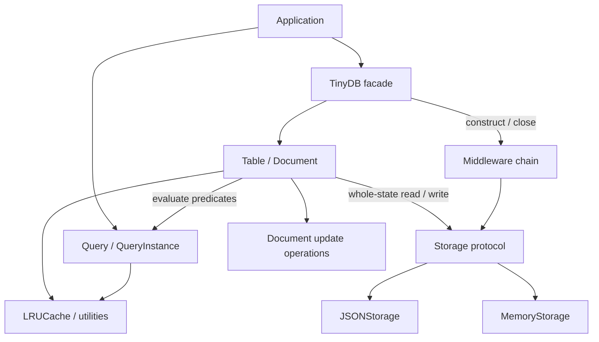

# TinyDB architecture at edff96a

Scope: `edff96aeb2616402e9489d46e90a592c05565621`, TinyDB 4.9.0. This describes the unchanged source at that commit. It is a code-verified reconstruction, not a recovered historical design document. File references below are relative to the repository root. The five constraints are recommendations grounded in existing contracts; they do not imply that every extension is mechanically enforced.

## 1. Components and interactions

**Database facade — `tinydb/database.py`.** `TinyDB` constructs a storage using the `storage` keyword or its default `JSONStorage`, forwarding other constructor arguments. It keeps a dictionary of opened table objects. Repeated `table(name)` calls return the same object while it remains registered; all tables share the database storage. Unknown attributes are forwarded to the default table. Special operations such as iteration and length have explicit forwarding methods because Python does not dispatch them through `__getattr__`. Database close calls storage close, and the context-manager exit closes an opened database. The facade owns table discovery/removal and database lifecycle, rather than implementing document queries itself.

**Tables and documents — `tinydb/table.py`.** `Table` owns CRUD operations for one table, document-ID allocation, and a per-table LRU query-result cache. `Document` subclasses `dict` and stores its ID separately as `doc_id`. The table's configurable `document_class` and `document_id_class` default to `Document` and `int`. `_read_table` obtains the complete storage state and selects the named table, treating an empty storage or missing table as empty. `_update_table` reads the database, converts the selected table's ID keys to the configured ID type, invokes an updater, converts keys back to strings, writes the database, and clears that table's query cache. Other tables are retained. This is a whole-state read/modify/write protocol, not a transactional storage engine. An exception can occur between Python state changes and a completed write, so callers should not assume general rollback guarantees.

**Queries — `tinydb/queries.py`.** `Query` builds field paths using attribute or bracket syntax and creates callable `QueryInstance` objects. `_generate_test` resolves path components and returns a nonmatch on `KeyError` or `TypeError` during traversal; exceptions in a particular final predicate follow that predicate's own handling. Query identity represents operation parameters and paths, allowing queries to be dictionary keys for table caches. Logical composition produces further query instances. A query whose hash representation cannot be hashed falls back to non-cacheable. `map` adds a callable path component and marks the query non-cacheable, since a callable may depend on mutable state. Queries depend on utility functions, without importing table or database implementations.

**Persistence — `tinydb/storages.py`.** The abstract `Storage` interface requires `read` and `write` and supplies an optional no-op `close`. A read returns the complete database dictionary or `None` for empty storage. The dictionary maps table names to dictionaries of document IDs and document contents. `JSONStorage` opens a file, handles creation according to its mode, loads JSON on reads, and serializes the whole state on writes. It flushes, calls `fsync`, and truncates leftover bytes. These steps do not constitute a cross-process locking or atomic replacement protocol. `MemoryStorage` keeps the dictionary in memory and returns it directly; it is not a deep-copy boundary. The facade does not require a specific concrete storage type.

**Middleware — `tinydb/middlewares.py`.** `Middleware` is a callable wrapper around a storage factory. Its call initializes the underlying storage with forwarded arguments and returns the wrapper itself. Unknown attributes delegate to the wrapped storage. This lets `TinyDB(storage=Middleware(StorageClass))` use the same construction pattern as an ordinary storage class. Wrappers can be nested. `CachingMiddleware` implements a separate read/write cache: reads populate it lazily, writes replace the cached whole state, and a counter determines when to flush. Its default write threshold is 1000. Close flushes pending writes, closes the underlying storage, marks the wrapper closed, and discards its cache. Read, write and flush reject use after close; repeated close returns. This storage-level cache is independent of each table's query-result cache.

**Utilities and update operations — `tinydb/utils.py`, `tinydb/operations.py`.** `LRUCache` uses an `OrderedDict` to limit query-cache entries and update recency. `freeze` recursively transforms common mutable containers into hashable counterparts for query identity; arbitrary objects may remain unhashable. `with_typehint` supplies a type-checking base while returning `object` at runtime, so `TinyDB`'s apparent table interface is chiefly delegation. Operations such as increment and delete return functions that mutate a document, which table update operations can invoke. These helpers do not own persistence or table registration.

The diagram's Storage arrows describe protocol use and implementations, not an extra dispatching object. When middleware is supplied, tables receive that wrapper as their storage and its calls eventually reach the concrete backend. Without middleware, they receive the backend directly.

## 2. Architecture decision records

### ADR 1 — Keep persistence behind a whole-state storage interface

**Status: Inferred.** The interface and call sites are verified; no historical decision discussion was consulted.

**Context.** Database and table operations must work with memory and file persistence. Storage-specific document access would couple CRUD to each backend.

**Decision.** Model persistence as `Storage.read()` and `write(data)` for the whole database; perform table selection and ID conversion above it (`storages.py:36–76`, `table.py:779–854`).

**Alternatives.** Per-document backend CRUD or persistence implemented directly in Table are conceptual alternatives, not claims about proposals made by the maintainers.

**Consequences.** A small backend interface supports replacement and wrapping. Updating a small part still transfers the whole state, and transactional isolation/concurrent-writer safety is not provided by this interface alone.

### ADR 2 — Represent query identity separately from evaluation

**Status: Inferred.** Source establishes behaviour, not the original decision process.

**Context.** Tables cache results for repeat predicates, while queries may be composed and can involve user functions.

**Decision.** Carry both an executable predicate and a hash representation in QueryInstance; propagate non-cacheability when evaluation cannot safely share a cached identity (`queries.py:75–142`, `queries.py:515–529`; the exact map definition is also discoverable by name).

**Alternatives.** Never caching predicates, or caching by callable object identity only, would reduce either reuse or the strength of semantic identity.

**Consequences.** Equivalent supported queries can share cache entries and boolean combinations preserve the query abstraction. Every parameter that changes matching must participate in identity. Mutable callable behaviour requires bypassing caches. Cache results are shallowly copied lists: their Document objects remain shared and must be treated as read-only under the current API (`table.py:249–298`).

### ADR 3 — Compose storage behaviour with callable wrappers

**Status: Inferred.** The construction mechanism is documented in source, but no historical alternatives were established.

**Context.** Caching should work with several backends and should be combinable with other storage wrappers.

**Decision.** Middleware holds a storage factory, initializes it through `__call__`, and forwards unknown operations; CachingMiddleware overrides the read/write/close lifecycle (`middlewares.py:11–73`, `middlewares.py:76–142`).

**Alternatives.** One caching subclass per backend or caching inside TinyDB could provide similar behaviour but spread storage policy across classes.

**Consequences.** Backend construction remains uniform and wrappers can nest. Cache lifecycle and forwarding require care: table-result invalidation does not by itself discard cached persistence data, while discarding dirty persistence data can lose writes. This observation follows from two independent caches, not from an assertion that the baseline offers an explicit refresh operation.

## 3. Five architectural constraints

1. **Preserve the whole-database storage contract.** Backend reads yield a table-name mapping or `None`; writes accept the whole state. Keep table selection and serialization of ID keys compatible with this protocol. Evidence: `storages.py:48–69`, `table.py:779–854`.
2. **Retain table customization and shared storage.** Use the configured table/document/ID classes rather than hard-coded assumptions when extending CRUD or lifecycle behaviour. Tables within a database operate on the same storage. Evidence: `database.py:127–131`, `table.py:77–82`, `table.py:835–848`.
3. **Make query identity and cacheability agree with behaviour.** Distinct semantic parameters need distinct identities; mapped or otherwise non-cacheable queries must stay non-cacheable through generated predicates and logical composition. Evidence: `queries.py:75–88`, `queries.py:116–142`, `queries.py:218–255`, `Query.map`.
4. **Keep query-result caching separate from persistence caching.** Table updates invalidate that table's query cache; storage middleware owns pending write counts and flushing. Preserve close/error behaviour when adding lifecycle methods. Evidence: `table.py:849–854`, `middlewares.py:97–142`.
5. **Maintain the callable storage-wrapper protocol.** Constructor arguments must reach the wrapped storage, and unhandled attributes should remain transparently forwarded. Avoid backend-specific assumptions in the facade. Evidence: `database.py:92–95`, `middlewares.py:24–73`.
